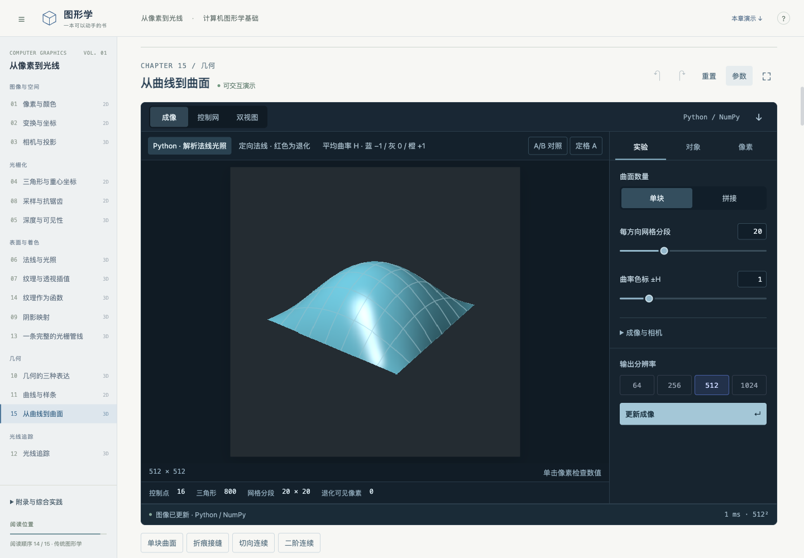

# 从像素到光线

**一本以 Python 为核心、可以直接操作的计算机图形学基础教材。**

十五章将数学推导、69 个书内演示和可读源码放在同一阅读流程中。从像素与坐标出发，经过光栅化、采样、纹理、光照和阴影，进入几何、曲线、曲面与基础光线追踪；最后运行一个可以逐像素检查的完整渲染示例。

适合会编程、了解一点线性代数的读者。无需 GPU，无需 Node 或前端构建。默认环境只有 NumPy、Markdown 解析器及其依赖，界面、数学字体与源码高亮资源随仓库提供。



## 开始阅读

先安装 [uv](https://docs.astral.sh/uv/getting-started/installation/)，然后运行：

```bash
git clone https://github.com/BITnene465/graphics-book.git
cd graphics-book
uv run --locked python tools/serve.py
```

浏览器会自动打开 [教材首页](http://localhost:5006/app?chapter=01)。首次启动需联网准备 Python 环境；之后不依赖外部 CDN。保持终端运行，按 `Ctrl+C` 停止。macOS 也可双击仓库根目录的 `start.command`。

```bash
# 换端口，或仅启动服务
uv run --locked python tools/serve.py --port 5007
uv run --locked python tools/serve.py --no-browser
```

本仓库提供可在本机运行的完整教材。交互需要 Python 服务，直接用 GitHub Pages 托管静态文件不能运行这些演示。

## 书中有什么

| 学习线索 | 内容 |
| --- | --- |
| 图像与空间 | 像素与颜色、二维与三维变换、变基与层级、相机与投影 |
| 光栅化与采样 | 重心坐标、裁剪与覆盖、抗锯齿、时间混叠、深度与遮挡 |
| 表面与成像 | 法线与局部光照、纹理过滤、环境与程序纹理、阴影、完整光栅管线 |
| 几何 | 隐式/参数/网格表示、Bézier 与样条、双三次曲面、微分与拼接 |
| 光线追踪与综合实践 | 求交、有限阴影射线、镜面反射，以及一个保存完整中间量的渲染器 |

侧栏按先修关系排序；编号与源码目录一致。初读时沿“下一章”进入即可。[详细目录](courses/graphics-foundations/README.md)列出先修知识、实验与学习标准。

演示嵌在相关段落之间。可拖动数学图中的点与向量、移动三维场景的相机与物体、检查像素、比较算法、撤销和重置。帮助统一收在右上角，章节侧栏和参数面板可折叠。源码按钮打开实际 Python 文件，并提供高亮、行号与下载。

## 数学、代码与浏览器

**正式渲染、几何求值、采样、光照与数值探针由 Python/NumPy 计算。** 浏览器负责输入、排版、图形呈现与即时操作；Three.js/WebGL 用于三维预览。预览与正式成像可能采用不同着色，以 Python 结果及数值探针为算法依据。

从 `lesson.md → core.py → exercises.py` 阅读。核心是普通函数，不依赖界面框架；较长主题按算法拆文件。35 道练习有意保留作答位置，完整参考实现位于相应核心文件。书内源码可以阅读和下载，修改 Python 后需在本机运行。

```bash
# 全书数学、渲染、HTTP、书内链接与下载包检查
uv run --locked python tools/check.py

# 完成练习后自检
uv run --locked python courses/graphics-foundations/modules/01-images-and-space/01-pixels/exercises.py

# 完整综合实践：生成图像、浮点中间量与像素数值链
uv run --locked python projects/foundation-renderer/main.py
```

[综合实践](courses/graphics-foundations/capstone.md)输出 `outputs/capstone/frame.png`、`frame.npz` 和 `pixel.json`。改变条件后，可核对重投影、法线、阴影可见率与线性颜色分解，验证图像背后的原因。

## 版本与范围

**1.0 基础版**以现有十五章及综合实践为完整学习单元。覆盖传统图形学的基础成像与几何，但不包含路径追踪、真实镜头、动画与物理模拟的完整课程。GAMES101 的全面覆盖及浏览器内 Python 编辑执行保留为[扩展 TODO](ROADMAP.md)。

[发布验收记录](docs/verification/release-1.0.md)列出实际检查范围，[更新记录](CHANGELOG.md)说明本版内容。

使用 CPU 即可。大多数综合演示最高支持 1024²，像素、相机、光照和光线追踪演示最高支持 2048²；分辨率、网格与样本数会影响速度。服务默认只监听本机，公网部署需另行配置托管、访问控制与计算预算。

早期 Panel 界面保留为可选兼容入口，不随默认环境安装：`uv run --locked --extra legacy panel serve app.py`。可选 GPU 依赖也不随默认环境安装；本版正式算法使用 NumPy，未实现 MPS 加速路径。

## 项目结构

```text
graphics-book/                   # 原工作区中的 graphic 子目录
├── courses/graphics-foundations/ # 正文、算法、练习与测试
├── projects/foundation-renderer/ # 完整综合实践
├── resources/                   # 数学补充与术语
├── web/                         # 书页、交互、本地前端资源
├── studio.py                    # 教材、源码和渲染接口
├── studio_render.py             # Python 成像与演示连接
├── teaching_figures.py          # 聚焦演示与公共图元
├── tools/                       # 启动与检查
├── docs/                        # 教学规范、验证与扩展规划
└── pyproject.toml / uv.lock      # 可复现的轻量环境
```

## 授权与参考

原创代码和代码示例采用 [MIT](LICENSE)，原创正文与教学插图采用 [CC BY 4.0](LICENSE-CONTENT)。外部资料和前端依赖保留各自许可，详见[授权与来源](NOTICE.md)。

本书参考 GAMES101、PBRT 等资料建立概念联系，在相应章节标注来源；中文讲解、场景与 Python 实验独立组织。仓库不包含课程 PPT、教科书 PDF 或付费资料。
